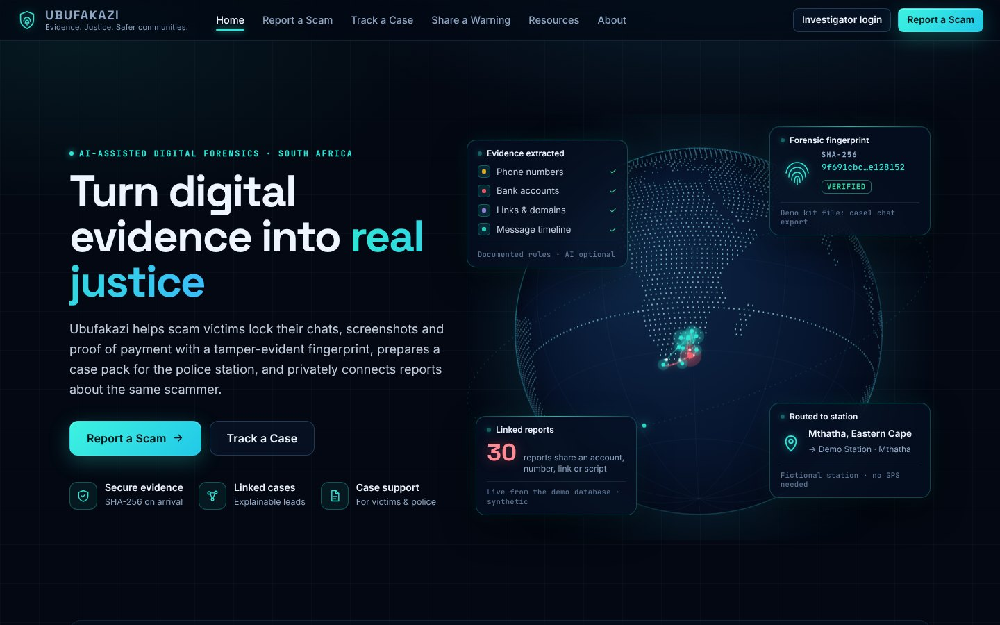
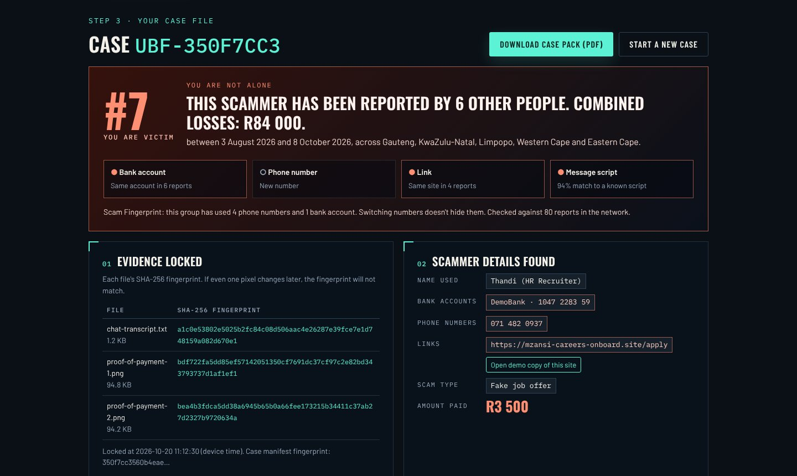
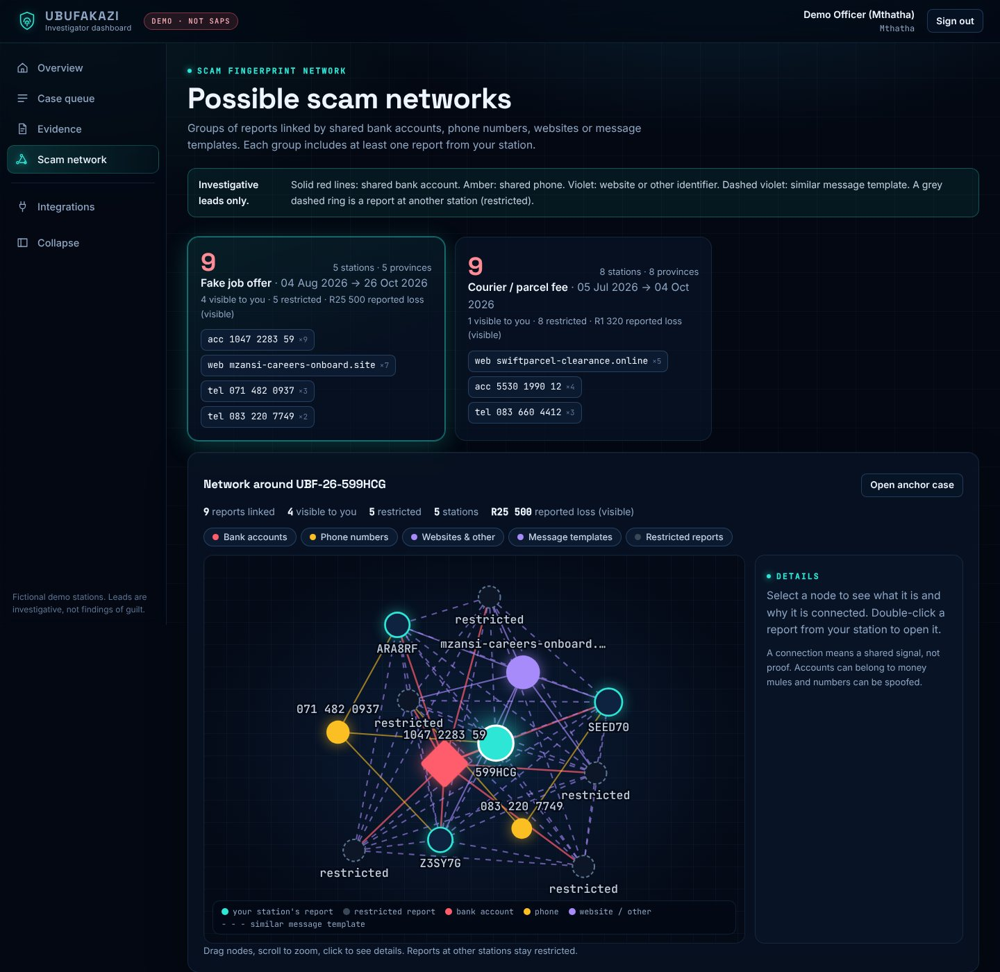

<div align="center">

# Ubufakazi

### Evidence that holds up when it matters.


**From scam victim to police-ready case file in 60 seconds.**

[](https://ubufakazi.onrender.com)
[](docs/Ubufakazi_Hackathon_Deck.pdf)

[](https://ubufakazi.onrender.com)


**Team CyberThreat** · Thabang Manyama (team lead) · Amani Tondi · Shaun Matlou

</div>



## Quick links

| What | Link |
|---|---|
| Live platform | **https://ubufakazi.onrender.com** |
| Report a scam · Track a case | [https://ubufakazi.onrender.com/report](https://ubufakazi.onrender.com/report) · [https://ubufakazi.onrender.com/track](https://ubufakazi.onrender.com/track) |
| Share a scam warning | [https://ubufakazi.onrender.com/share](https://ubufakazi.onrender.com/share) |
| Investigator dashboard (demo logins on request) | [https://ubufakazi.onrender.com/police](https://ubufakazi.onrender.com/police) |
| What is connected | [https://ubufakazi.onrender.com/integrations](https://ubufakazi.onrender.com/integrations) |
| Pitch deck (PDF) | [docs/Ubufakazi_Hackathon_Deck.pdf](docs/Ubufakazi_Hackathon_Deck.pdf) |
| Demo evidence kit (3 victims, zip) | [ubufakazi-demo-evidence-kit.zip](https://ubufakazi.onrender.com/demo-kit/ubufakazi-demo-evidence-kit.zip) |
| Test pack for judges (70 cases, zip) | [ubufakazi-test-pack.zip](https://ubufakazi.onrender.com/test-pack/ubufakazi-test-pack.zip) |
| Original offline MVP | [https://ubufakazi.onrender.com/mvp](https://ubufakazi.onrender.com/mvp) |

The old address, ubufakazi.netlify.app, forwards to the live platform.

## The problem

South Africans lose billions of rand a year to scams: fake job offers, fake couriers, marketplace sellers, romance and crypto schemes. Most victims never get a case opened that goes anywhere, because:

- **Evidence is messy.** It sits in WhatsApp chats, screenshots and proof-of-payment slips that police and banks can't easily use, and that can be questioned later.
- **Every report looks small on its own.** One R3 500 loss gets ignored. Seven victims of the same syndicate is a case, but nobody connects them.
- **Scammers switch numbers.** Blocking one number does nothing when they use a new one the next day.

## What Ubufakazi does

*Ubufakazi* is isiZulu for "evidence" or "testimony".

1. **Lock the evidence.** Every chat, screenshot and payment slip gets a SHA-256 fingerprint the moment it's reported. If one pixel changes later, the fingerprint won't match.
2. **Pull out the scammer's details.** South African bank accounts, phone numbers (+27 / 0XX), links, emails and rand amounts are found automatically, along with a timeline of the scam: offer, payment request, pressure, payment, silence.
3. **Link the victims with a Scam Fingerprint.** Accounts, phones and link domains are stored only as keyed HMAC-SHA256 hashes, plus a fingerprint of the message script. That means a scammer who changes their number is still linked by the bank account, the site or the script.
4. **Write it up.** The app writes an affidavit-style statement in English, isiZulu, isiXhosa, Afrikaans or Sesotho, plus a bank fraud report and a downloadable PDF case pack.





## Try the original 60-second MVP

1. Open **https://ubufakazi.onrender.com/mvp** and click **Build a case file**.
2. Click **"Fake job offer"**, then **Build my case file**.
3. The red card says **"You are victim #7"**: 6 earlier reports and R84 000 lost, linked by the **same bank account** even though the scammer used a **new phone number**.
4. Scroll through the evidence fingerprints, scammer details, timeline, statement (switch languages with the tabs) and bank report. Click **Download case pack (PDF)**.
5. Click **Add my report**, then **Start a new case**, then **"Same scammer, new number & new account"**, then build.
   It now says **victim #8**, linked by the **link** and the **message script**, even though both the phone and the bank account changed.

Click **Reset demo data** in the footer before presenting, so the count starts at #7 again.

**Test it with your own files:** download the [test pack](https://ubufakazi.onrender.com/test-pack/ubufakazi-test-pack.zip). It has 70 fictional cases, each with a WhatsApp chat export and proof-of-payment PDFs: 50 in English and 5 each in isiZulu, isiXhosa, Afrikaans and Sesotho. The language is in every file name. Upload any case and compare the result with the guide PDF.

## What's real in this prototype

| Feature | How it works |
|---|---|
| Evidence locking | Real SHA-256 of every file and the chat text (Web Crypto API), plus a case manifest fingerprint |
| Extraction | Rules for SA bank accounts, phone numbers, links, emails and rand amounts, with keywords in 5 languages |
| Timeline | Parses real WhatsApp exports in both the Android and iPhone formats |
| Scam Fingerprint | HMAC-SHA256 of identifiers plus message-script similarity (3-word shingles), matched against a fictional network of 80 earlier reports and 3 syndicates |
| Statements | English, isiZulu, isiXhosa, Afrikaans and Sesotho drafts (have a fluent speaker check the translations) |
| Case pack | PDF made in the browser with jsPDF |
| Investigation material | A fictional scammer website, social profile and bank confirmation letter, all clearly labelled as demo content |
| Tested | All 70 test-pack cases pass an automated check (`tools/validate_test_pack.py`) |

## Security and privacy

- **Nothing is uploaded.** Chats, files and names never leave the browser in this prototype.
- **Strict security headers.** Content Security Policy, X-Frame-Options and related headers are set in `site/_headers`. There are no third-party scripts, trackers or font services: everything is bundled.
- **Safe rendering.** All user text goes into the page through `textContent`, never `innerHTML`, so a malicious chat can't inject code.
- **Hashed identifiers.** The demo network (`site/assets/seed.js`) stores scammer identifiers only as keyed hashes.
- **Consent first.** A report joins the network only when the victim clicks **Add my report**.

**Prototype limits:** the HMAC key is in the browser and added reports are saved only in that browser. In the full build, fingerprints are computed on a server in a South African cloud region with a secret key, evidence is encrypted, an independent RFC 3161 timestamp authority (such as FreeTSA) proves when files were locked, and the system is designed for POPIA compliance.

## Ubufakazi 2.0 (branch `ubufakazi-2`)

The MVP above runs entirely in the browser. **Ubufakazi 2.0** adds the real backend that the hackathon plan describes:

- **Telegram reporting bot.** It guides a victim step by step in plain language, fingerprints every file the moment it arrives, has a `/stop` quick exit at every step, and treats abuse reports safety-first.
- **Web reporting, tracking and verification.** `/report` (with a Quick exit button), `/track` with a private receipt key, and `/verify`, which checks a file's SHA-256 on your own device.
- **Server-side evidence pipeline.** Originals are checked by their bytes, stored read-only and hashed on receipt. Derived text is kept separate. Statements are drafted in 5 languages, and there is a PDF case pack for the complainant and a restricted one for police.
- **Private police console at `/police`.** Password plus two-factor sign-in, CSRF protection, and **station isolation**: officers see only their station's reports. Reports at other stations appear only as restricted stubs.
- **Explainable scam intelligence.** Leads come from shared accounts, phone numbers, websites, social profiles, usernames, payment references and message templates. Every lead states its reason, and there is an interactive investigation graph.
- **Fictional DemoBank dashboard at `/bank-demo`.** Masked accounts with no victim data. Its actions are simulated and audited.
- **Hash-chained audit log.** Every view, download, verification and status change is recorded, and tampering is detected.

```bash
cd server
pip install -r requirements.txt
python -m ubufakazi_server.setup                 # random secrets, demo accounts, 80 synthetic reports
uvicorn ubufakazi_server.app:app --port 8000     # open http://localhost:8000
python -m pytest -q                              # acceptance tests A-H
```

Read **[docs/UBUFAKAZI-2.md](docs/UBUFAKAZI-2.md)** for the demo script, architecture, intelligence rules, the tests and the known limitations. Everything is fictional: Ubufakazi is not connected to SAPS or to any bank, and it issues no case numbers.

## Hackathon plan (27–28 October 2026)

| Who | Builds |
|---|---|
| **Thabang Manyama** | Telegram bot and FastAPI backend on Render, server-side HMAC and FreeTSA timestamps |
| **Amani Tondi** | Gemini AI extraction for screenshots and messy chats, with the current rules as the fallback |
| **Shaun Matlou** | Supabase database for the shared victim network, investigator dashboard, polished PDF case pack |

## Run it yourself

There's no build step: the site is plain HTML, CSS and JavaScript.

```bash
git clone https://github.com/Don4chnge/ubufakazi.git
cd ubufakazi/site
python3 -m http.server 8000
# open http://localhost:8000
```

**Deploy:** the full platform runs on Render (`render.yaml`, branch `ubufakazi-2`) with a Neon Postgres database. `netlify.toml` now forwards the old ubufakazi.netlify.app address to it.

## Project structure

```
site/                          the website (deployed to Netlify)
  index.html                   landing screen and case builder
  _headers                     security headers
  assets/app.js                engine: lock, extract, timeline, link, write, PDF
  assets/hero.js, hero.css     animated fingerprint landing screen
  assets/app.css               styles
  assets/seed.js               fictional network of 80 reports (hashes only)
  assets/vendor/               jsPDF (MIT licence)
  assets/fonts/                Oswald, Barlow, Barlow Condensed, IBM Plex Mono (SIL OFL)
  scam-demo/                   fictional scammer website, profile and bank letter
  demo-kit/                    3-victim evidence kit
  test-pack/                   70-case test pack, guide PDF and zip
docs/                          pitch deck PDF and screenshots
tools/
  make_seed.py                 builds the fictional network
  make_demo_kit.py             builds the demo evidence kit
  make_test_pack.py            builds the 70-case test pack
  validate_test_pack.py        runs every test case through the site in a headless browser
server/                        Ubufakazi 2.0 backend (FastAPI)
  ubufakazi_server/            app, bot, conversation, services, storage, intel, casepack, audit, police
  ubufakazi_server/web/        police console, bank demo, report/track/verify pages
  tests/                       acceptance tests A-H
Dockerfile                     2.0 server image (serves site/ too)
netlify.toml                   Netlify settings
```

## Disclaimer

All names, numbers, accounts, websites and reports in this project are **fictional** and made for demonstration only. "DemoBank" is not a real bank. Ubufakazi is a hackathon prototype, not legal advice, and it doesn't replace reporting to SAPS or your bank.

---

<div align="center">

**Team CyberThreat**, a threat to cybercriminals. HackSecure 2026.

</div>
